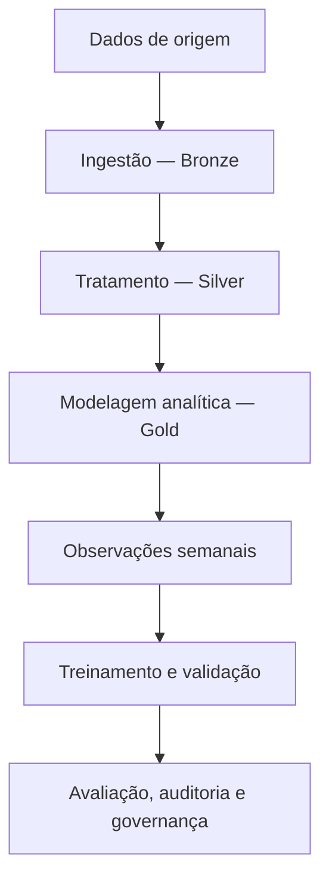

# Arquitetura técnica — Stone Data Challenge

## Objetivo

Organizar diferentes fontes de dados relacionadas a contratos, clientes, transações financeiras e comunicações, criando uma estrutura analítica para exploração, validação e experimentação de Machine Learning.

## Visão da arquitetura

## Camada Bronze

Responsável pela ingestão inicial e preservação dos dados das fontes.

A separação dessa camada facilita a rastreabilidade das informações recebidas e a identificação de problemas nas etapas seguintes.

## Camada Silver

Responsável pela padronização e preparação dos dados.

As verificações implementadas incluem consistência de tipos, integridade das informações e reconciliação entre as fontes e as tabelas transformadas.

## Camada Gold

Responsável pela organização das informações em dimensões e fatos analíticos.

Principais entidades:

| Entidade | Granularidade |
|---|---|
| Dimensão de clientes | Cliente |
| Dimensão de contratos | Contrato |
| Fato diário de contratos | Contrato e data de referência |
| Fato diário de TPV | Documento e data de transação |
| Fato de comunicações | Registro de comunicação |

A definição explícita da granularidade é importante para evitar duplicações e agregações incorretas.

## Camada analítica

A partir dos dados preparados, são construídas observações semanais de contratos, com características financeiras e histórico de comunicações.

As features históricas são calculadas considerando a data de cada observação.

## Machine Learning

A experimentação inclui:

- Modelo de referência e regressão logística.
- Separação temporal entre treinamento, validação e teste.
- Calibração de probabilidades.
- Avaliação de métricas discriminativas e probabilísticas.
- Análise de estabilidade.
- Auditoria da construção das features e do indicador-alvo.

## Qualidade e governança

O projeto possui testes automatizados e relatórios de auditoria para identificar inconsistências, registrar riscos e apoiar a interpretação dos resultados.

A classificação atual do modelo é **EXPERIMENTAL**.

## Demonstração sintética

Existe também um pipeline independente, executável com dados artificiais, para demonstrar as transformações Bronze → Silver → Gold e validar regras básicas de integridade e reconciliação.

Essa demonstração não equivale à reprodução integral do pipeline analítico original.