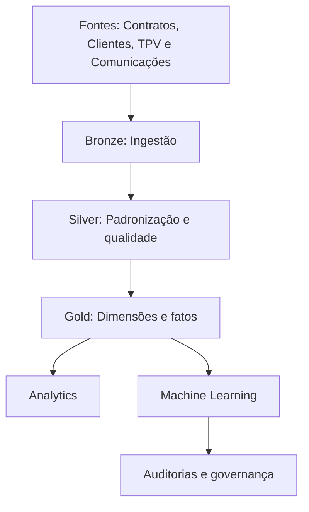

# Evidências técnicas — Stone Data Challenge

## Visão geral

Projeto de Engenharia de Dados, Analytics e Machine Learning, desenvolvido com Python, DuckDB, Parquet, scikit-learn e pytest.

A solução organiza dados financeiros e operacionais em uma arquitetura Bronze, Silver e Gold, com validações automatizadas, experimentação preditiva e auditorias de confiabilidade.

## Arquitetura

## Volumes processados

| Entidade | Registros |
|---|---:|
| Clientes | 14.265 |
| Contratos | 14.756 |
| Contratos diários | 8.061.006 |
| TPV diário | 4.408.597 |
| Comunicações | 403.740 |

## Experimento de Machine Learning

- Base analítica: 801.725 observações semanais.
- Contratos distintos: 14.746.
- Algoritmo: regressão logística.
- Separação temporal com embargo de 14 dias.
- Calibração de probabilidades pelo método de Platt.

### Resultados no teste

| Métrica | Resultado |
|---|---:|
| ROC AUC | 0,7849 |
| PR AUC | 0,7208 |
| Brier Score original | 0,2527 |
| Brier Score calibrado | 0,2025 |
| Taxa observada | 44,82% |
| Probabilidade média prevista | 54,24% |

A diferença entre a probabilidade média prevista e a taxa observada foi de aproximadamente 9,42 pontos percentuais.

**Status: EXPERIMENTAL.** O indicador-alvo ainda necessita de validação semântica e as probabilidades apresentam problemas de calibração.

## Auditorias

| Auditoria | Evidência |
|---|---|
| Integridade do indicador-alvo | 97.188 janelas completas analisadas |
| Reconstrução da regra original | 0 divergências |
| Comparação com aproximação alternativa | 723 divergências |
| Reconstrução temporal das características | 97.188 observações |
| Divergências nas características reconstruídas | 0 |

A auditoria temporal não comprova integralmente a disponibilidade operacional histórica dos dados.

## Qualidade e testes

- 126 testes aprovados no ambiente local.
- 12 testes dedicados à demonstração sintética.
- Workflow de CI para a demonstração sintética.
- Reconciliação financeira e verificações de integridade.
- Demonstração independente dos dados originais.

## Limitações

Os resultados não representam um modelo validado para produção.

A interpretação do indicador-alvo, a calibração das probabilidades e a disponibilidade temporal dos dados exigem validações adicionais.

As associações observadas entre campanhas e pagamentos não estabelecem relações causais.

## Documentação complementar

- [Arquitetura](arquitetura.md)
- [Metodologia](metodologia.md)
- [Resultados](resultados.md)
- [Limitações](limitacoes.md)
- [Demonstração reproduzível](demo_reprodutivel.md)